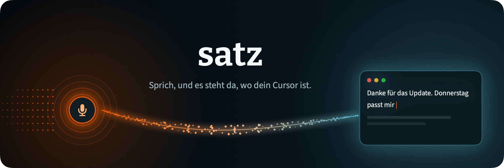
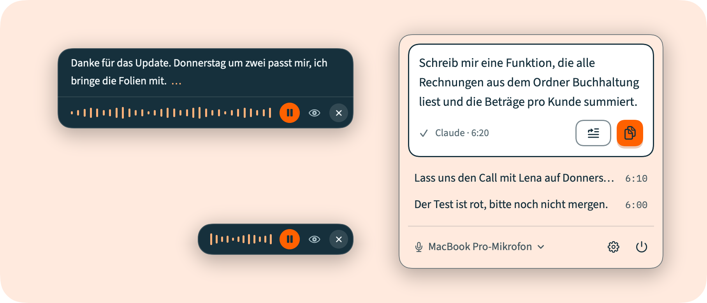

**English** · [Deutsch](README.de.md)

### Tap a key twice, speak, and your words appear wherever you are typing. In any app, on Mac, Windows and Linux.

 

  

  <a href="https://cdn.prozesshub.eu/assets/clients/dpa/videos/marketing/satz-erklaervideo/satz-erklaervideo-de-v2.mp4"><b>▶ Watch the explainer video</b></a> (in German, 55 seconds, voice and music AI-generated)

## Why satz

Most dictation apps want something from you first: an account, a subscription, or a second AI that rewrites what you said. satz does one thing. It records you, turns the audio into text with the model of your choice, and inserts the result where your cursor is. The model runs at a transcription service or, if you like, on your own computer.

- **Works everywhere you type.** Mail, Slack, your editor, a chat with an AI. If it has a text cursor, satz can fill it.
- **Very accurate, very cheap.** By default satz uses Microsoft's MAI-Transcribe 2 via OpenRouter: 2.0 % wrong words at Artificial Analysis (September 2026), against 3.3 % for OpenAI's GPT Transcribe, at a third of the price. You pay the provider directly, for what you use.
- **Clean up the text if you want.** Off by default. Turn it on to fix punctuation, smooth phrasing, or use your own instructions.
- **You see it while you speak.** A small card shows your text as you speak. Click into it to change where the next words go, pause to think, or throw it all away and undo that.
- **Nothing to set up on a server.** No account, no telemetry. Your key stays on your computer.
- **Offline if you want.** The *Local* provider runs Whisper on your computer: a one-time download, free after that, and nothing leaves the machine.

## Download

| System | File | |
|---|---|---|
| **macOS 14 or later** (Apple silicon and Intel) | [satz-mac.zip](https://cdn.prozesshub.eu/assets/clients/dpa/downloads/satz/latest/satz-mac.zip) | Unzip, drag satz into "Applications" |
| **Windows** (Intel and AMD) | [satz-windows-x64.zip](https://cdn.prozesshub.eu/assets/clients/dpa/downloads/satz/latest/satz-windows-x64.zip) | Unzip anywhere, run `satz.exe` |
| **Windows 11 on ARM** | [satz-windows-arm64.zip](https://cdn.prozesshub.eu/assets/clients/dpa/downloads/satz/latest/satz-windows-arm64.zip) | Unzip anywhere, run `satz.exe` |
| **Ubuntu, Debian** (x64) | [satz-linux-amd64.deb](https://cdn.prozesshub.eu/assets/clients/dpa/downloads/satz/latest/satz-linux-amd64.deb) | `sudo apt install ./satz-linux-amd64.deb` |
| **Ubuntu, Debian** (ARM) | [satz-linux-arm64.deb](https://cdn.prozesshub.eu/assets/clients/dpa/downloads/satz/latest/satz-linux-arm64.deb) | `sudo apt install ./satz-linux-arm64.deb` |
| **Other Linux** | [x64](https://cdn.prozesshub.eu/assets/clients/dpa/downloads/satz/latest/satz-linux-x64.tar.gz) · [ARM](https://cdn.prozesshub.eu/assets/clients/dpa/downloads/satz/latest/satz-linux-arm64.tar.gz) | Unpack, run `./satz` |

Older versions and the source code are on the [releases page](https://github.com/dpa-plus/satz/releases/latest) on GitHub. The SHA-256 checksums of all files are in [SHA256SUMS.txt](https://cdn.prozesshub.eu/assets/clients/dpa/downloads/satz/latest/SHA256SUMS.txt).

**On first launch your computer asks once.** satz is not yet signed with a paid Apple or Microsoft certificate, so your computer asks before opening it for the first time:

- **Mac:** Open satz and close the warning, then go to *System Settings → Privacy & Security* and click *Open Anyway*.
- **Windows:** SmartScreen says it protected your PC. Click *More info*, then *Run anyway*.

## Getting started

1. **Get a key.** Create one at [openrouter.ai/keys](https://openrouter.ai/keys) and add a few dollars of credit. With MAI-Transcribe 2 an hour of speaking costs about 10 cents, so five dollars last a long time. Keys from OpenAI and Groq work too.
2. **Open satz.** On the Mac, setup asks for the key, the microphone and permission to paste, and ends with a test sentence. On Windows and Linux the settings open for the key.
3. **Dictate.** Click into any text field and tap the shortcut twice:

| | Start and stop | Discard |
|---|---|---|
| Mac | right **⌘** twice | **Esc** |
| Windows, Linux | right **Ctrl** twice | **Esc** |

Speak, tap twice again, and the text is inserted. satz starts on its own when you log in. You can turn that off in the settings.

## What you can do

**While speaking**
- **Pause** with the microphone button to think. Your text appears at every pause.
- **Click anywhere in the text**, and what you say next goes there. On the Mac you can also type into it by hand.
- **Hide the text** with the eye if you only want the small waveform.
- **Throw it away** with ×, then you can click *Undo* for a few seconds, and *Restore* in the menu bar after that.
- **Move the card** wherever you want. It stays where you put it and never leaves the screen.
- **Music pauses on its own** while you speak (Spotify, Apple Music, YouTube in the browser, anything the system reports as playing) and resumes when you are done. Only what was playing, and only what satz paused.

**Finding things again**
- **Open satz** again (on the Mac from "Applications" or via Spotlight, on Windows and Linux by starting satz again) and you get its window: **History** and **Settings**, one click (or ⌘1 / ⌘2) apart. The history holds everything you dictated, sorted by day and searchable. One click copies, × forgets an entry.
- **Keep** the last 10, 50, 200 or all dictations, or none. The menu bar shows the last four.
- **Paste** (Mac): The button next to *Copy* in the menu bar puts your last text into the text field you are in. This only works while a text field has the cursor.

**In the settings**
- **Vocabulary:** Names and terms the model should spell the way you want ("Kubernetes", a colleague's name).
- **Replacements:** Say "open bracket" and you get `(`, say "new line" for a line break. You can add your own trigger words.
- **Spoken in:** German or English, separate from the app's language.
- **Shortcut:** Tap to start and stop, or hold while you speak. On the Mac also a custom key combination or a mouse button.
- **Clean up text** (off until you turn it on): A language model removes the "ums" or rewrites your text before it is inserted, as much as you choose. See [Cleaning up the text](#cleaning-up-the-text).
- **Keep text on the clipboard:** Off by default, so whatever you had copied comes back after pasting. When it is on, the dictated text stays there and you can paste it again.
- **Color** (Mac): four colors, light and dark, Liquid Glass from macOS 26.

## Built so no words get lost

| What goes wrong in other apps | What satz does |
|---|---|
| The last word gets cut off | The microphone stays open for 400 ms after you stop |
| Chopped-up audio mangles words | Cloud transcription gets the whole recording; the limits of local models are described further down |
| It spins forever | Every request has a timeout; an error stays on the card with *Retry* |
| A dropped connection loses your speech | The audio is kept until it is sent |
| Pasting fails silently | satz tells you and leaves the text on the clipboard |
| It pastes into the wrong app | The text goes back to the app you started in |
| It eats your clipboard | Whatever you had copied comes back after pasting |

## Providers and models

| Provider | Default model | Notes |
|---|---|---|
| **OpenRouter** (recommended) | Microsoft MAI-Transcribe 2 | One key, every speech model OpenRouter has |
| OpenAI | GPT Transcribe | Also GPT-4o (mini) Transcribe, Whisper |
| Groq | Whisper Large v3 Turbo | Very fast |
| Microsoft | MAI-Transcribe 2 | Directly from Azure AI Speech: the key of your Speech resource and its region (North Europe by default, in the EU) or the address of your own resource. Also regular Azure Speech |
| Google | Gemini 3.5 Transcribe | Directly from the Gemini API: a key from [Google AI Studio](https://aistudio.google.com/apikey). With a free key Google may use your audio to improve its products; turn on billing to prevent that. A recording longer than about 7 minutes is rejected before it is sent |
| Custom | your URL and your model | Any OpenAI-compatible endpoint |
| Local | Whisper Large v3 Turbo | On your own computer, no key, see below |

The model menu is the provider's **live list**, so new models appear without a new satz. Next to each one is how many words it gets wrong, by the word error rate from [Artificial Analysis](https://artificialanalysis.ai/speech-to-text) (the same roughly 8 hours of speech for every model, lower is better), and what an hour of speaking costs. The best are at the top. Prices as satz measured them in October 2026:

| Model | Wrong words | per hour |
|---|---|---|
| Microsoft MAI-Transcribe 2 (default, Clean mode, uses your vocabulary) | 2.0 % | $0.10 |
| Microsoft MAI-Transcribe 2, directly from Microsoft | 2.0 % | $0.10 until 31 Dec 2026, then $0.36 |
| Google Gemini 3.5 Transcribe, directly from Google (Smart mode, uses your vocabulary) | 2.6 % | $0.30 |
| Microsoft Azure Speech, directly from Microsoft | not measured | $0.36 |
| Microsoft MAI-Transcribe 1.5 | 2.4 % | $0.36 |
| Mistral Voxtral Small | 2.8 % | $0.18 |
| OpenAI GPT Transcribe | 3.3 % | $0.28 |
| Mistral Voxtral Mini 3B | 3.8 % | $0.06 |
| OpenAI GPT-4o Transcribe | 4.0 % | $0.23 |
| xAI Grok STT | 4.0 % | $0.10 |
| OpenAI Whisper | 4.1 % | $0.37 |
| Google Chirp 3 | 4.3 % | $1.00 |
| OpenAI GPT-4o mini Transcribe | 4.5 % | $0.12 |
| OpenAI Whisper Large v3 Turbo | 4.6 % | $0.01 |
| Qwen3 ASR, Voxtral Mini Transcribe, Universal-3.5 Pro, Whisper Large v3, Fish Audio | not measured | $0.01 to $0.44 |

A few models that OpenRouter lists are missing because they fail at dictation (no German, speaker tags in the text, rejected requests). *Other model …* takes any model ID by hand. Each provider keeps its own key and its own model, so you can switch back and forth.

**On your own computer.** Choose *Local*, and the settings show the models as cards, the way [Handy](https://github.com/cjpais/Handy) does: *Your models* (on this computer, the one in use first) and *Available models*. Each card says in one sentence what the model is good for, has one bar for accuracy and one for speed, and names the languages it understands and its size. Click an available card to download it (with a progress bar and *Cancel*), click one of yours to use it. The speed bar comes from a measurement satz runs on your computer right after the download, with a 10 s public-domain audiobook excerpt; before that the Mac uses an estimate based on Argmax's measurements on the closest Apple chip, or a rough guess. Point at a bar to see the numbers behind it. Clicking a provider in the settings only shows it; *Use Local* or a click on one of your models switches to it.

| | Mac | Windows and Linux |
|---|---|---|
| Whisper Large v3 Turbo | 646 MB, via WhisperKit on the Neural Engine. The default. On an M1 a 627 MB version that runs there. | 981 MB, on the processor. The default. |
| Whisper Large v3 Turbo, full size | 1.6 GB, a little more accurate. | |
| Whisper Large v3 | 3.1 GB, slow. | 1.4 GB, most accurate, slow. |
| Whisper Medium | | 786 MB |
| Whisper Small | 486 MB, mostly for English. | 328 MB |
| Whisper Base | 147 MB, rough. | 149 MB, fast, rough. |
| Whisper Tiny | 77 MB, very rough. | 99 MB, very rough. |
| Distil-Whisper Large v3 | 607 MB, English only, fast. | 950 MB (v3.5), English only. |
| Cohere Transcribe | 2.9 GB, via sherpa-onnx. Most accurate in German on the Open ASR Leaderboard, 14 languages: understands the language set under *Spoken in*. | 2.9 GB, same. |
| Parakeet Ultra | 632 MB, via FluidAudio/CoreML on Apple's Neural Engine. Detects 25 languages automatically, including German and English. | Not available: this CoreML build requires macOS. |
| Parakeet V3 | 670 MB, via sherpa-onnx. Fast and accurate, 25 European languages, including German. | 670 MB, same. |
| Parakeet German (primeLine) | 671 MB, Parakeet V3 fine-tuned for German by primeLine (a community export), German only. | 671 MB, same. |
| Canary 1B v2 | 1.4 GB (a community export), accurate. English, German, Spanish, French: understands the language set under *Spoken in*. | 1.4 GB, same. |
| Qwen3-ASR 0.6B | 987 MB, small, 30 languages, detects the language itself, a little behind Parakeet V3 in German. | 987 MB, same. |
| Canary 180M Flash | 207 MB, very fast. English, German, Spanish, French: understands the language set under *Spoken in*. | 207 MB, same. |
| Parakeet V2 | 661 MB, English only, the best for English. | 661 MB |
| Bark 3.0 Pro | 1.23 GB, English only, via FluidAudio/CoreML on Apple's Neural Engine. Requires Apple silicon and macOS 15. Non-commercial use only (CC BY-NC 4.0). | Not available: this CoreML build requires macOS. |
| Moonshine Base | 287 MB, English only, very fast. | 287 MB |
| Moonshine Tiny | 124 MB, English only, extremely fast. | 124 MB |
| SenseVoice | 240 MB, very fast. Chinese, English, Japanese, Korean, Cantonese. | 240 MB |
| Whisper Large v3 Turbo German | | 983 MB, German only. |
| Apple's speech recognition | Built into macOS 26; macOS may fetch its language pack once. Available instantly, but only understands the language set under *Spoken in* and makes little use of your vocabulary. | |

On the Mac, Parakeet Ultra uses [FluidAudio](https://github.com/FluidInference/FluidAudio) 0.17.3. The 632 MB are downloaded from a pinned commit and verified with SHA-256. After the download, recognition runs offline; the language is not forced. The CoreML build is only available on the Mac. Ultra comes from [Moondream](https://huggingface.co/moondream/parakeet-ultra), is based on NVIDIA Parakeet V3 and is licensed under CC-BY-4.0; FluidInference creates the CoreML export.

[Bark 3.0 Pro](https://huggingface.co/ConwayResearch/Underdog-Bark-3.0-Pro) by Conway Research is another English-only option on the Mac. The CoreML files (1,234,604,822 bytes including licenses and attributions) come from the pinned commit `d87f288a9a0b0cdb92228057e168ce575b300a6b`; every file is verified with SHA-256. macOS compiles the models once, and the compiled models stay with the downloaded files. That takes up additional space. Recognition stays offline and uses FluidAudio 0.17.3, with the 15-second encoder on the Neural Engine and preprocessing and decoder on the CPU. FluidAudio processes longer recordings as one recording. The weights are licensed under CC BY-NC 4.0, not under satz's MIT license; commercial use needs a separate license from Conway Research. satz only downloads them once you select the model and keeps the licenses in the model folder. The published error rates do not prove an improvement over Ultra in this Mac build, so Ultra is neither replaced nor deselected automatically. This entry is missing on Windows and Linux because the integrated build requires CoreML; no new Python/CUDA runtime is shipped for it.

The other Parakeet models, Canary, Moonshine, SenseVoice, Cohere Transcribe and Qwen3-ASR run via [sherpa-onnx](https://github.com/k2-fsa/sherpa-onnx); Windows on ARM only has the Whisper models because sherpa-onnx has no build for it. The four newest are offered like the others and download nothing until you click them.

On the Mac the error rates come from Argmax, for exactly the versions satz downloads (English, and German where they measured it); on Windows and Linux it is German on FLEURS, for the original models. Both are fetched once a day, with the numbers satz ships as a fallback. For the remaining models the accuracy bar is a rough guess (Handy's). Click the speed bar of a model on your computer to measure it again.

Parakeet, Canary, Moonshine, SenseVoice, Cohere Transcribe and Qwen3-ASR run via [sherpa-onnx](https://github.com/k2-fsa/sherpa-onnx) (Apache-2.0) on ONNX Runtime, which the Mac app ships (about 19 MB more in the download). Their files come one by one, each from a pinned commit and verified against its SHA-256, from the exports by [csukuangfj](https://huggingface.co/csukuangfj) and [csukuangfj2](https://huggingface.co/csukuangfj2) (the newest) on Hugging Face; Parakeet German and Canary 1B v2 are community exports, by [x-ian](https://huggingface.co/x-ian/sherpa-onnx-parakeet-primeline-de-int8) and by [Sarphix](https://huggingface.co/Sarphix/canary-1b-v2-sherpa-onnx-int8). Licenses: [Parakeet V3](https://huggingface.co/nvidia/parakeet-tdt-0.6b-v3), [Parakeet V2](https://huggingface.co/nvidia/parakeet-tdt-0.6b-v2), [Canary 180M Flash](https://huggingface.co/nvidia/canary-180m-flash) and [Canary 1B v2](https://huggingface.co/nvidia/canary-1b-v2) by NVIDIA, CC-BY-4.0; [Parakeet German](https://huggingface.co/primeline/parakeet-primeline) by primeLine, CC-BY-4.0; [Cohere Transcribe](https://huggingface.co/CohereLabs/cohere-transcribe-03-2026) by Cohere, Apache-2.0; [Qwen3-ASR](https://huggingface.co/Qwen/Qwen3-ASR-0.6B) by Alibaba's Qwen team, Apache-2.0; [Moonshine](https://huggingface.co/UsefulSensors/moonshine-base) by Useful Sensors, MIT; [SenseVoice](https://github.com/FunAudioLLM/SenseVoice) by FunAudioLLM, [FunASR model license](https://github.com/modelscope/FunASR/blob/main/MODEL_LICENSE). Your vocabulary does not go to these models (your replacements still apply), except to Qwen3-ASR, which takes it as hotwords and is checked like Whisper: the text with the vocabulary is only kept if it has not lost a word. Moonshine, SenseVoice, Canary and Cohere Transcribe listen well for about 30 seconds, and the Qwen3-ASR decoder only holds about 15 seconds of speech. A longer recording therefore goes through them in pieces, cut at their quietest points, never in the middle of a word; it still stays one recording and one text. Cohere Transcribe and Canary have to be told the language (*Spoken in*): with the wrong one, Cohere translates or gets stuck in a loop. Cohere also writes sentences for steady noise such as a fan, so a piece that is only a steady level does not go to Cohere. Parakeet German writes "ss" for "ß".

Whisper detects on its own whether you speak German or English. The first time after the download, the Mac prepares the model for its chip, which takes a few minutes, once. Your vocabulary goes to Whisper as a hint, but only if that changes at most a word here and there: with a hint, Whisper sometimes left out a sentence in another language or repeated an earlier one. That is why satz compares the text word by word with one made without the hint and keeps the latter if words were missing or added. Silence never goes to Whisper, which makes something up for it. A sentence in another language in the middle of a long recording can still get lost locally; the cloud models handle that better. *Delete* moves the model to the Trash.

**Speed.** MAI-Transcribe usually answers in one to two seconds, but now and then a request hangs for ten. If there is no answer after 2.5 seconds, satz asks a second time and takes whichever answer comes first, for a fraction of a cent.

## Cleaning up the text

Off until you turn it on. With *Clean up text* in the settings, a language model revises what you said before satz inserts it. You choose how much (*Strength*):

| | What changes |
|---|---|
| **Punctuation only** | Punctuation and capitalization. Every word stays. |
| **Light** (the default) | Plus no "ums", no stuttering and no words you took back: "Monday, no, Tuesday" becomes "Tuesday". |
| **Smooth** | Plus grammar and clumsy sentences. |
| **Polished** | Rewritten as if you had typed it, with paragraphs and lists. |
| **Custom prompt** | Your own instruction, for example "translate into English" or "write as a bulleted list". |

The instructions of the chosen level are always visible. The entry *View full prompt for "…"* shows the whole prompt. Your vocabulary goes along so names stay spelled the way you want. English words in German sentences stay English.

**The four built-in levels edit a dictation without answering it.** "What time is it?" should stay a question, and "Write an email to Jonas" should stay a sentence. With these levels satz checks the result against what you said: if it detects an answer, a translation nobody asked for, or a comment, a changed number, a changed sign or "not", or with *Punctuation only* a changed word, it inserts what you said, and the card says *Not cleaned up*. *Custom prompt* allows the transformation you ask for and does not apply these sanity checks. At every level, a failed, empty, truncated or late answer falls back to what you said. The history keeps what you said next to the cleaned-up text (*Original* on the row), unless you have turned the history off.

**What it adds.** Every model in the menu shows the seconds it adds to a dictation and what it costs per hour of speaking, estimated for the length of your own dictations and measured as soon as you use it or click *Try it*. *Try it* sends a sample text (or your own) through the model you are looking at, before you switch to it.

| Provider | Default model | Added per dictation | Per hour of speaking |
|---|---|---|---|
| **OpenRouter** (your existing key) | Gemini 3.5 Flash-Lite | about 0.8 s | about $0.05 |
| OpenAI | GPT-6 Luna | about 1.5 s | about $0.01 |
| Anthropic | Claude Haiku 5.5 | about 1.6 s | about $0.02 |
| Google (your Gemini key) | Gemini 3.5 Flash-Lite | about 0.8 s | about $0.05 |
| Groq | gpt-oss-120b | about 0.7 s | about $0.02 |
| Cerebras | Qwen3.8 27B | about 0.5 s | about $0.08 |
| Mistral | Mistral Small | about 0.9 s | about $0.02 |
| DeepSeek | DeepSeek V4.1 Flash | about 1.1 s | about $0.03 |
| xAI | Grok 4.7 | about 4.6 s | about $0.20 |
| Microsoft Azure | your deployment | | same as OpenAI |
| Apple (on the Mac) | Apple Intelligence, on your Mac | measured | free |
| Ollama, LM Studio | the models you have installed | measured | free |
| Custom | any OpenAI-compatible address | measured | |

Via OpenRouter you can also choose Qwen3.8 27B (the fastest, 0.6 s), DeepSeek V4.1 Flash, Claude Haiku 5.5 (rewrites best for the price), GPT-6 Luna, GLM-5.3, MiniMax M3, Mistral Large 4, Gemini 3.8 Flash, Kimi K3, DeepSeek V4 Pro, and for the best quality Claude Sonnet 5.5, GPT-6 Sol, GPT-6.1 Sol, Gemini 4 Argon, Claude Opus 5.5 or Grok 4.7. All of them went through satz's own test set (questions, "ignore your instructions", mixed German and English, self-corrections, lists) before they made the list; models that answered, translated or wrote their reasoning into the text were left out.

Apple's model is free and never leaves your Mac (macOS 26 with Apple Intelligence turned on), but it is small: in testing it answered a question in the text and translated English into German. satz then usually inserts the original, so it works best for *Punctuation only* and *Light*. Small models in Ollama or LM Studio behave the same way.

The times were measured in October 2026 from Germany via OpenRouter; the prices are the providers' list prices, and OpenRouter's are fetched live.

## Your key and your data

- Your audio goes directly from your computer to the provider you chose. There is no satz server. With *Local* it never leaves your computer.
- The key is stored only on your computer: on the Mac in `~/Library/Application Support/satz/keys`, readable only by your user. satz never shows it to you again after saving.
- If *Clean up text* is on, the text (never the audio) also goes, with your vocabulary, to the model you chose for it; with Apple's model it stays on your Mac.
- The history keeps the latest dictations in a file only you can read. *Clear* in the settings deletes it.

## Questions

**Is it free?** satz is free and open source (MIT). You pay the transcription provider for what you use: about 10 cents per hour of speaking with MAI-Transcribe 2 via OpenRouter. With *Local* it costs nothing at all.

**Does it work offline?** With the *Local* provider, yes: Whisper runs on your computer after a one-time download. The other providers need the internet.

**Which languages?** All the ones the model understands. MAI-Transcribe 2 and Whisper handle dozens. The app itself is available in English and German.

**Linux with Wayland?** Wayland lets apps neither watch the keyboard nor type into other apps. satz works anyway: see [the notes for Linux](desktop/README.md#linux-und-wayland) (in German).

<b>Build it yourself</b>

 

**Mac** (Xcode 27 or later, with Swift 6.4 and the macOS SDK):

    make app                     builds dist/satz.app
    make run                     builds and launches
    make share                   universal build as dist/satz.zip and dist/satz-mac.dmg
    make test                    fetches native dependencies if needed, then runs the offline tests

The Mac packages from `make share` stay locally signed. For Developer ID and
notarization there is the separate [release process](scripts/macos/README.md).
The new updater uses Sparkle: a notice in the open window, then install and
restart if you want. A dictation that is running or has failed waits until it
is finished or discarded. Existing versions up to 0.4.5 need one manual
download to get the updater. The [signed update feed](scripts/updates/README.md)
is part of every future release. Windows and Linux also show a notice and open
the matching download; installation there is still done by hand.

**Windows and Linux** (Electron, also builds on a Mac): see [desktop/README.md](desktop/README.md).

    cd desktop && npm install
    npm test
    npm run dist:win             release/*.zip
    npm run dist:linux           release/*.deb, *.tar.gz

**Structure**

    Sources/SatzKit    audio, WAV, transcription client, replacements, keys
    Sources/SatzMac    the Mac app: shortcut, card, pasting, menu, settings, setup
    Tests/             tests for SatzKit
    desktop/           the Windows and Linux app, with the same core in TypeScript

**Test mode** plays through a real dictation without microphone and keyboard and never pastes into the app you are using:

    satz --test-audio a.wav:b.wav --dev-control /tmp/state.json

Commands arrive as distributed notifications named `plus.dpa.satz.dev` (`press`, `mic`, `caret:<index>`, `discard`, `undo`, `dump`, `picture`, `settings`, `close`). The finished text goes into the state file.

    satz --snapshot <dir>        every screen as PNG, light and dark
    make hero / make showcase    the images in this README

Live tests talk to a real endpoint and are skipped without a key:

    SATZ_TEST_API_KEY=... SATZ_TEST_BASE_URL=https://openrouter.ai/api/v1 make test

## License

The source code of satz itself is licensed under MIT. See [LICENSE](LICENSE). Made by [DPA Plus](https://dpa.plus).

Bundled dependencies keep their own licenses. The packages for Windows x64 and Linux contain a native library under GPL-3.0-or-later. The licenses, the source code and the build instructions are in the [notes on bundled software](Resources/Licenses/README.md) and in the [corresponding source code download](https://github.com/dpa-plus/satz/releases/download/v0.4.8/satz-0.4.8-source.tar.gz).
