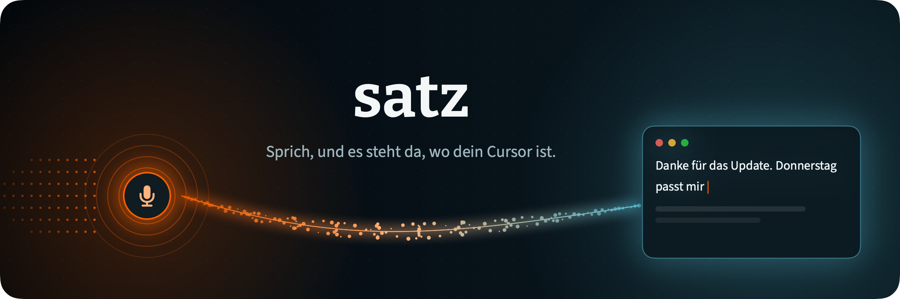
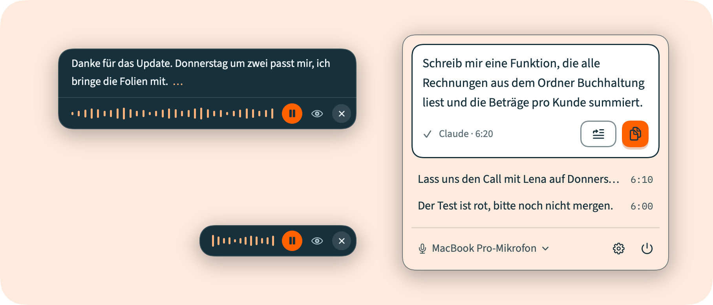

### Tap a key twice, talk, and your words appear where you were typing. In every app, on Mac, Windows and Linux.

 

  

## Why satz

Most dictation apps want something from you first: an account, a subscription, or a second AI that rewrites what you said. satz does one thing. It records you, turns the audio into text with the model you pick, and types the result where your cursor is. The model runs at a transcription service, or, if you prefer, on your own computer.

- **Works everywhere you type.** Mail, Slack, your editor, a chat with an AI. If it has a text cursor, satz can fill it.
- **Very accurate, very cheap.** By default it uses Microsoft's MAI-Transcribe 2 through OpenRouter: 2.0% word errors on Artificial Analysis (September 2026), against 3.3% for OpenAI's GPT Transcribe, at a third of the price. You pay the provider directly, for what you use.
- **Optional text cleanup.** Off by default. Enable it to correct punctuation, smooth phrasing or use your own instructions.
- **See it while you talk.** A small card shows your text as you go. Click into it to change where the next words land, pause to think, or throw it away and undo.
- **Nothing to set up on a server.** No account, no telemetry. Your key stays on your computer.
- **Offline if you want.** Provider *Local* runs Whisper on your own computer: a one-time download, then free, and nothing leaves the machine.

## Download

| System | File | |
|---|---|---|
| **macOS 14 or newer** (Apple chip and Intel) | [satz-mac.zip](https://github.com/dpa-plus/satz/releases/latest/download/satz-mac.zip) | Unzip, drag satz into Applications |
| **Windows** (Intel and AMD) | [satz-windows-x64.zip](https://github.com/dpa-plus/satz/releases/latest/download/satz-windows-x64.zip) | Unzip anywhere, run `satz.exe` |
| **Windows 11 on ARM** | [satz-windows-arm64.zip](https://github.com/dpa-plus/satz/releases/latest/download/satz-windows-arm64.zip) | Unzip anywhere, run `satz.exe` |
| **Ubuntu, Debian** (x64) | [satz-linux-amd64.deb](https://github.com/dpa-plus/satz/releases/latest/download/satz-linux-amd64.deb) | `sudo apt install ./satz-linux-amd64.deb` |
| **Ubuntu, Debian** (ARM) | [satz-linux-arm64.deb](https://github.com/dpa-plus/satz/releases/latest/download/satz-linux-arm64.deb) | `sudo apt install ./satz-linux-arm64.deb` |
| **Other Linux** | [x64](https://github.com/dpa-plus/satz/releases/latest/download/satz-linux-x64.tar.gz) · [ARM](https://github.com/dpa-plus/satz/releases/latest/download/satz-linux-arm64.tar.gz) | Unpack, run `./satz` |

All files are on the [releases page](https://github.com/dpa-plus/satz/releases/latest).

**The first start asks once.** satz is not yet signed with a paid Apple or Microsoft certificate, so your computer asks before opening it the first time:

- **Mac:** open satz and close the warning, then go to *System Settings → Privacy & Security* and click *Open Anyway*.
- **Windows:** SmartScreen says it protected your PC. Click *More info*, then *Run anyway*.

## Get started

1. **Get a key.** Create one at [openrouter.ai/keys](https://openrouter.ai/keys) and add a few dollars of credit. With MAI-Transcribe 2 an hour of talking costs about 10 cents, so five dollars lasts a long time. OpenAI and Groq keys work too.
2. **Open satz.** On the Mac, setup asks for the key, the microphone and permission to paste, and ends with a test sentence. On Windows and Linux, Settings opens for the key.
3. **Dictate.** Click into any text field and tap the shortcut twice:

| | Start and finish | Throw away |
|---|---|---|
| Mac | right **⌘** twice | **Esc** |
| Windows, Linux | right **Ctrl** twice | **Esc** |

Talk, tap twice again, and the text is pasted. satz starts by itself when you log in; you can switch that off in Settings.

## What you can do

**While you talk**
- **Pause** with the microphone button to think. Your text appears at each pause.
- **Click anywhere in the text** and what you say next goes there. On the Mac you can also type in it by hand.
- **Hide the text** with the eye if you only want the small waveform.
- **Throw it away** with ×, then *Undo* for a few seconds, or *Restore* from the menu bar after that.
- **Move the card** anywhere. It stays where you put it and never leaves the screen.
- **Music pauses by itself** while you talk (Spotify, Apple Music, YouTube in the browser, anything the system lists as playing) and plays on when you are done. Only what was playing, and only what satz paused.

**Find it again**
- **Open satz** again (from Applications or Spotlight on the Mac, by starting satz again on Windows and Linux) and you get its window: **History** and **Settings**, one click (or ⌘1 / ⌘2) apart. History has everything you dictated, by day, with search. A click copies, × forgets one.
- **Keep** the last 10, 50, 200 or all of them, or none. The menu bar shows the last four.
- **Insert** (Mac): the button next to *Copy* in the menu bar puts your latest text into the text field you are in. It only works while a text field has the cursor.

**In Settings**
- **Vocabulary:** names and terms the model should spell your way ("Kubernetes", your colleague's name).
- **Replacements:** say "open bracket" and get `(`, say "new line" for a line break. Add your own trigger words.
- **Spoken in:** German or English, separately from the app's language.
- **Shortcut:** tap to start and stop, or hold while you talk. On the Mac also your own key combination or a mouse button.
- **Clean up the text** (off until you switch it on): a language model removes the "um"s or rewrites your text before it is pasted, at the strength you choose. See [Cleaning up the text](#cleaning-up-the-text).
- **Keep text on the clipboard:** off by default, so whatever you had copied comes back after pasting. On, the dictated text stays there to paste again.
- **Look** (Mac): four colours, light and dark, Liquid Glass on macOS 26.

## Built not to lose your words

| What goes wrong in other apps | What satz does |
|---|---|
| The last word gets clipped | The microphone stays open 400 ms after you stop |
| Cut-up audio garbles words | Cloud transcription receives the whole recording; local model limits are explained below |
| It spins forever | Every request has a time limit; a failure stays on the card with *Retry* |
| A dropped connection loses your speech | The audio is kept until it has been sent |
| The paste silently fails | It says so and leaves the text on the clipboard |
| It pastes into the wrong app | The text goes back to the app you started in |
| It eats your clipboard | What you had copied is put back after pasting |

## Providers and models

| Provider | Default model | Notes |
|---|---|---|
| **OpenRouter** (recommended) | Microsoft MAI-Transcribe 2 | One key, every speech model OpenRouter has |
| OpenAI | GPT Transcribe | Also GPT-4o (mini) Transcribe, Whisper |
| Groq | Whisper Large v3 Turbo | Very fast |
| Microsoft | MAI-Transcribe 2 | Straight from Azure AI Speech: your Speech resource's key and its region (North Europe, in the EU, by default), or your own resource address. Also plain Azure Speech |
| Google | Gemini 3.5 Transcribe | Straight from the Gemini API: a key from [Google AI Studio](https://aistudio.google.com/apikey). With a free key Google may use your audio to improve its products; switch billing on to prevent that. A recording over about 7 minutes is refused before it is sent |
| Custom | your URL and model | Any OpenAI-compatible endpoint |
| Local | Whisper Large v3 Turbo | On your own computer, no key, see below |

The model menu is the provider's **live list**, so new models show up without a new satz. Next to each: how many words it gets wrong, from [Artificial Analysis](https://artificialanalysis.ai/speech-to-text)' word error rate (the same ~8 hours of speech for every model, lower is better), and what an hour of talking costs. The best come first. Prices as satz measured them in October 2026:

| Model | Wrong words | per hour |
|---|---|---|
| Microsoft MAI-Transcribe 2 (default, clean mode, uses your vocabulary) | 2.0 % | $0.10 |
| Microsoft MAI-Transcribe 2, straight from Microsoft | 2.0 % | $0.10 until 31 Dec 2026, then $0.36 |
| Google Gemini 3.5 Transcribe, straight from Google (smart mode, uses your vocabulary) | 2.6 % | $0.30 |
| Microsoft Azure Speech, straight from Microsoft | not measured | $0.36 |
| Microsoft MAI-Transcribe 1.5 | 2.4 % | $0.36 |
| Mistral Voxtral Small | 2.8 % | $0.18 |
| OpenAI GPT Transcribe | 3.3 % | $0.28 |
| Mistral Voxtral Mini 3B | 3.8 % | $0.06 |
| OpenAI GPT-4o Transcribe | 4.0 % | $0.23 |
| xAI Grok STT | 4.0 % | $0.10 |
| OpenAI Whisper | 4.1 % | $0.37 |
| Google Chirp 3 | 4.3 % | $1.00 |
| OpenAI GPT-4o mini Transcribe | 4.5 % | $0.12 |
| OpenAI Whisper Large v3 Turbo | 4.6 % | $0.01 |
| Qwen3 ASR, Voxtral Mini Transcribe, Universal-3.5 Pro, Whisper Large v3, Fish Audio | not measured | $0.01 to $0.44 |

A few models OpenRouter lists are left out because they fail with dictation (no German, speaker tags in the text, refused requests). "Other model" takes any model id by hand. Each provider keeps its own key and model, so you can switch back and forth.

**On your own computer.** Choose *Local* and Settings shows the models as cards, the way [Handy](https://github.com/cjpais/Handy) does: *Your models* (on this computer, the one in use first) and *Available models*. Each card says in one sentence what the model is good for, has a bar for accuracy and one for speed, and names the languages it hears and its size. Click an available card to download it (with a progress bar and *Cancel*), click one of yours to use it. The speed bar comes from satz's own measurement on your computer right after the download, with a 10 s public-domain audiobook clip; before that, the Mac uses an estimate from Argmax's measurements on the nearest Apple chip, or a rough rating. Point at a bar for the numbers behind it. Clicking a provider in Settings only shows it; *Use Local*, or clicking one of your models, switches to it.

| | Mac | Windows and Linux |
|---|---|---|
| Whisper Large v3 Turbo | 646 MB, via WhisperKit on the Neural Engine. The default. On an M1, a 627 MB build that runs there. | 981 MB, on the processor. The default. |
| Whisper Large v3 Turbo, full size | 1.6 GB, a little more accurate. | |
| Whisper Large v3 | 3.1 GB, slow. | 1.4 GB, the most accurate, slow. |
| Whisper Medium | | 786 MB |
| Whisper Small | 486 MB, mostly for English. | 328 MB |
| Whisper Base | 147 MB, rough. | 149 MB, fast, rough. |
| Whisper Tiny | 77 MB, very rough. | 99 MB, very rough. |
| Distil-Whisper Large v3 | 607 MB, English only, fast. | 950 MB (v3.5), English only. |
| Cohere Transcribe | 2.9 GB, via sherpa-onnx. The most accurate in German on the Open ASR Leaderboard, 14 languages: hears the language set in *Spoken in*. | 2.9 GB, the same. |
| Parakeet V3 | 670 MB, via sherpa-onnx. Fast and accurate, 25 European languages, German among them. | 670 MB, the same. |
| Parakeet German (primeLine) | 671 MB, Parakeet V3 retrained for German by primeLine (a community export), German only. | 671 MB, the same. |
| Canary 1B v2 | 1.4 GB (a community export), accurate. English, German, Spanish, French: hears the language set in *Spoken in*. | 1.4 GB, the same. |
| Qwen3-ASR 0.6B | 987 MB, small, 30 languages, finds the language itself, a bit behind Parakeet V3 in German. | 987 MB, the same. |
| Canary 180M Flash | 207 MB, very fast. English, German, Spanish, French: hears the language set in *Spoken in*. | 207 MB, the same. |
| Parakeet V2 | 661 MB, English only, the best for English. | 661 MB |
| Moonshine Base | 287 MB, English only, very fast. | 287 MB |
| Moonshine Tiny | 124 MB, English only, extremely fast. | 124 MB |
| SenseVoice | 240 MB, very fast. Chinese, English, Japanese, Korean, Cantonese. | 240 MB |
| Whisper Large v3 Turbo German | | 983 MB, German only. |
| Apple's speech recognition | Built into macOS 26; macOS may fetch its language pack once. Instant, but hears only the language set in *Spoken in* and barely uses your vocabulary. | |

Parakeet, Canary, Moonshine, SenseVoice, Cohere Transcribe and Qwen3-ASR run through [sherpa-onnx](https://github.com/k2-fsa/sherpa-onnx); Windows on ARM has the Whisper models only, since sherpa-onnx has no build for it. The four newest are offered like the rest and download nothing until you click them.

On the Mac the error rates are Argmax's, for the exact builds satz downloads (English, and German where they measured it); on Windows and Linux, German on FLEURS for the original models. Both are fetched once a day, with the numbers satz ships as a fallback. For the other models the accuracy bar is a rough rating (Handy's). Click the speed bar of a model on your computer to measure it again.

Parakeet, Canary, Moonshine, SenseVoice, Cohere Transcribe and Qwen3-ASR run through [sherpa-onnx](https://github.com/k2-fsa/sherpa-onnx) (Apache-2.0) on ONNX Runtime, which the Mac app carries inside (about 19 MB more in the download). Their files come one by one, each from a pinned commit and checked against its SHA-256, from [csukuangfj's exports](https://huggingface.co/csukuangfj) and [csukuangfj2's](https://huggingface.co/csukuangfj2) (the newest) on Hugging Face; Parakeet German and Canary 1B v2 are community exports, [x-ian's](https://huggingface.co/x-ian/sherpa-onnx-parakeet-primeline-de-int8) and [Sarphix's](https://huggingface.co/Sarphix/canary-1b-v2-sherpa-onnx-int8). Licences: [Parakeet V3](https://huggingface.co/nvidia/parakeet-tdt-0.6b-v3), [Parakeet V2](https://huggingface.co/nvidia/parakeet-tdt-0.6b-v2), [Canary 180M Flash](https://huggingface.co/nvidia/canary-180m-flash) and [Canary 1B v2](https://huggingface.co/nvidia/canary-1b-v2) by NVIDIA, CC-BY-4.0; [Parakeet German](https://huggingface.co/primeline/parakeet-primeline) by primeLine, CC-BY-4.0; [Cohere Transcribe](https://huggingface.co/CohereLabs/cohere-transcribe-03-2026) by Cohere, Apache-2.0; [Qwen3-ASR](https://huggingface.co/Qwen/Qwen3-ASR-0.6B) by Alibaba's Qwen team, Apache-2.0; [Moonshine](https://huggingface.co/UsefulSensors/moonshine-base) by Useful Sensors, MIT; [SenseVoice](https://github.com/FunAudioLLM/SenseVoice) by FunAudioLLM, [FunASR's model licence](https://github.com/modelscope/FunASR/blob/main/MODEL_LICENSE). Your vocabulary is not given to these models (your replacements still apply), except to Qwen3-ASR, which takes it as hotwords and is checked like Whisper: the text with the word list is kept only if it lost no words. Moonshine, SenseVoice, Canary and Cohere Transcribe hear about 30 seconds well, and Qwen3-ASR's decoder holds only about 15 seconds of speech, so a longer recording goes through them in pieces cut at its quietest moments, never mid-word; it is still one recording and one text. Cohere Transcribe and Canary have to be told the language (*Spoken in*): told the wrong one, Cohere translates or loops. Cohere also writes sentences for steady noise such as a fan, so a piece that is one steady level is not sent to it. Parakeet German writes "ss" for "ß".

Whisper tells German from English by itself. The first time after the download, the Mac prepares the model for its chip, which takes a few minutes, once. Your vocabulary is given to Whisper as a hint, but only when that changes no more than a word here and there: with a hint, Whisper sometimes left out a sentence in another language or repeated an earlier one, so satz compares the text word by word with one made without the hint and keeps that one if words went missing or appeared. Silence is never sent to Whisper, which makes something up for it. A sentence in another language in the middle of a long recording can still get lost locally; the cloud models handle that better. *Delete* puts the model in the Trash.

**Speed.** MAI-Transcribe usually answers in one or two seconds, but now and then a request hangs for ten. When no answer has come after 2.5 seconds, satz asks a second time and takes whichever answer comes first, for a fraction of a cent.

## Cleaning up the text

Off until you switch it on. With *Clean up the text* in Settings, a language model edits what you said before satz pastes it. You choose how much:

| | What changes |
|---|---|
| **Punctuation only** | Punctuation and capitals. Every word stays. |
| **Light** (the default) | Also no "um", stutters or words you took back: "Monday, no, Tuesday" becomes "Tuesday". |
| **Smooth** | Also grammar and clumsy sentences. |
| **Polished** | Rewritten as if you had typed it, with paragraphs and lists. |
| **Own prompt** | Your own instruction, for example "translate into English" or "write it as a bullet list". |

The selected preset's instructions are always visible. Its named *Show full prompt* control reveals the complete prompt. Your vocabulary goes with it, so names stay spelled your way. English words in German sentences stay English.

**The four built-in presets edit dictation without answering it.** "What time is it?" should stay a question, and "write a mail to Jonas" should stay a sentence. For these presets, satz checks the result against what you said: if it detects a reply, an unrequested translation or a comment, a changed number, sign or "not", or a changed word with *Punctuation only*, it pastes what you said and the card says *Not cleaned up*. *Own prompt* allows the transformation you request and does not apply those meaning checks. With any preset, a failed, empty, cut-off or late response falls back to what you said. The history keeps what you said next to the cleaned text (*Original* on the row), unless you switched the history off.

**What it adds.** Every model in the menu shows the seconds it adds to a dictation and what it costs per hour of talking, estimated for the length of your own dictations and measured once you have used it or clicked *Try*. *Try* runs a sample (or your own text) through the model you are looking at before you switch to it.

| Provider | Default model | Adds per dictation | Per hour of talking |
|---|---|---|---|
| **OpenRouter** (your existing key) | Gemini 3.5 Flash-Lite | about 0.8 s | about $0.05 |
| OpenAI | GPT-6 Luna | about 1.5 s | about $0.01 |
| Anthropic | Claude Haiku 5.5 | about 1.6 s | about $0.02 |
| Google (your Gemini key) | Gemini 3.5 Flash-Lite | about 0.8 s | about $0.05 |
| Groq | gpt-oss-120b | about 0.7 s | about $0.02 |
| Cerebras | Qwen3.8 27B | about 0.5 s | about $0.08 |
| Mistral | Mistral Small | about 0.9 s | about $0.02 |
| DeepSeek | DeepSeek V4.1 Flash | about 1.1 s | about $0.03 |
| xAI | Grok 4.7 | about 4.6 s | about $0.20 |
| Microsoft Azure | your deployment | | as at OpenAI |
| Apple (Mac) | Apple Intelligence, on your Mac | measured | free |
| Ollama, LM Studio | the models you installed | measured | free |
| Custom | any OpenAI-compatible address | measured | |

Through OpenRouter you can also pick Qwen3.8 27B (the fastest, 0.6 s), DeepSeek V4.1 Flash, Claude Haiku 5.5 (rewrites best for the price), GPT-6 Luna, GLM-5.3, MiniMax M3, Mistral Large 4, Gemini 3.8 Flash, Kimi K3, DeepSeek V4 Pro, and for the best quality Claude Sonnet 5.5, GPT-6 Sol, GPT-6.1 Sol, Gemini 4 Argon, Claude Opus 5.5 or Grok 4.7. All of them were run through satz's own test set (questions, "ignore your instructions", mixed German and English, self-corrections, lists) before they made the list; models that answered, translated or wrote their reasoning into the text were left out.

Apple's model is free and never leaves your Mac (macOS 26 with Apple Intelligence on), but it is small: in the test it answered a question in the text and translated English into German. satz then mostly pastes the original, so it is best for *Punctuation only* and *Light*. Small models in Ollama or LM Studio behave the same way.

The times were measured from Germany through OpenRouter in October 2026; the prices are the providers' list prices, and OpenRouter's are fetched live.

## Your key and your data

- Your audio goes straight from your computer to the provider you chose. There is no satz server. With *Local*, it never leaves your computer.
- The key is stored on your computer only: on the Mac in `~/Library/Application Support/satz/keys`, readable only by your user. satz never shows it again after you save it.
- With *Clean up the text* on, the text (never the audio) also goes to the model you chose for it, with your vocabulary; with Apple's model it stays on your Mac.
- The history keeps the last few dictations, in a file only you can read. *Clear* in Settings deletes it.

## Questions

**Is it free?** satz is free and open source (MIT). You pay the transcription provider for what you use: about 10 cents per hour of talking with MAI-Transcribe 2 on OpenRouter. With *Local* it costs nothing at all.

**Does it work offline?** With the provider *Local*, yes: Whisper runs on your computer after a one-time download. The other providers need the internet.

**Which languages?** Whatever the model understands. MAI-Transcribe 2 and Whisper handle dozens. The app itself is in English and German.

**Linux with Wayland?** Wayland does not let apps watch the keyboard or type into other apps. satz still works: see [the notes for Linux](desktop/README.md#linux-and-wayland).

<b>Build it yourself</b>

 

**Mac** (Xcode 27 or newer, including Swift 6.4 and the macOS SDK):

    make app                     build dist/satz.app
    make run                     build and launch
    make share                   universal build zipped as dist/satz.zip
    make test                    fetch native dependencies if needed, then run offline tests

**Windows and Linux** (Electron, builds on a Mac too): see [desktop/README.md](desktop/README.md).

    cd desktop && npm install
    npm test
    npm run dist:win             release/*.zip
    npm run dist:linux           release/*.deb, *.tar.gz

**Layout**

    Sources/SatzKit    audio, WAV, transcription client, replacements, keys
    Sources/SatzMac    the Mac app: shortcut, card, paste, menu, settings, setup
    Tests/             tests for SatzKit
    desktop/           the Windows and Linux app, sharing the same core in TypeScript

**Test mode** drives a real dictation without a microphone or keyboard, and never pastes into the app you are using:

    satz --test-audio a.wav:b.wav --dev-control /tmp/state.json

Commands arrive as distributed notifications named `plus.dpa.satz.dev` (`press`, `mic`, `caret:<index>`, `discard`, `undo`, `dump`, `picture`, `settings`, `close`). The finished text goes to the state file.

    satz --snapshot <dir>        every surface as PNGs, light and dark
    make hero / make showcase    the pictures in this README

Live tests talk to a real endpoint and are skipped without a key:

    SATZ_TEST_API_KEY=... SATZ_TEST_BASE_URL=https://openrouter.ai/api/v1 make test

## Licence

satz's own source is MIT. See [LICENSE](LICENSE). Made by [DPA Plus](https://dpa.plus).

Bundled dependencies keep their own licenses. The Windows x64 and Linux packages include a GPL-3.0-or-later native library. See the [bundled software notices](Resources/Licenses/README.md) and the [corresponding source download](https://github.com/dpa-plus/satz/releases/download/v0.4.3/satz-0.4.3-source.tar.gz) for the licenses, source and build instructions.
